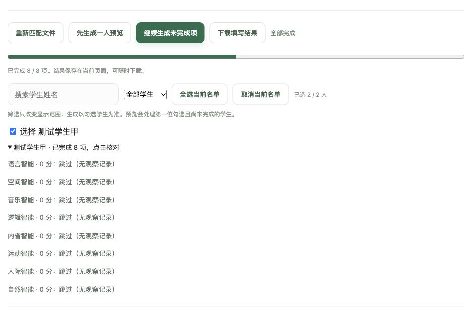

# 单人预览与批量生成

[返回指南首页](Home.md)

> 图中学生评价为 `/`，所以示例结果全部为 0 分。0 分代表跳过，不是孩子能力评分示例。

## 先预览一人

1. 选定学生、智能和字数。
2. 有课堂评价时填写个人访问口令。
3. 点击“先生成一人预览”，系统只处理第一位勾选且仍有未完成项的学生。
4. 展开学生姓名，核对分数、语气、事实和字数。

要指定某人预览，先取消其他学生的勾选。可直接编辑结果，或者重新生成该学生的所选智能或指定维度。

## 满意后处理全班

重新勾选其余学生，点击“开始批量生成”或“继续生成未完成项”。预览成功的项目已写入正式结果，后续不会重复调用。

每次最多处理两个智能，逐组保存成功结果。失败组自动重试一次；仍失败时可继续补做或下载已完成部分。

## 调整字数后重新试

改变字数设置后，可以生成该设置下尚未完成的学生项目。同一字数下的成功项会被跳过；当前全部完成时按钮禁用，防止误点重复生成。

[下一步：暂停与草稿恢复](Draft-and-Resume.md)
