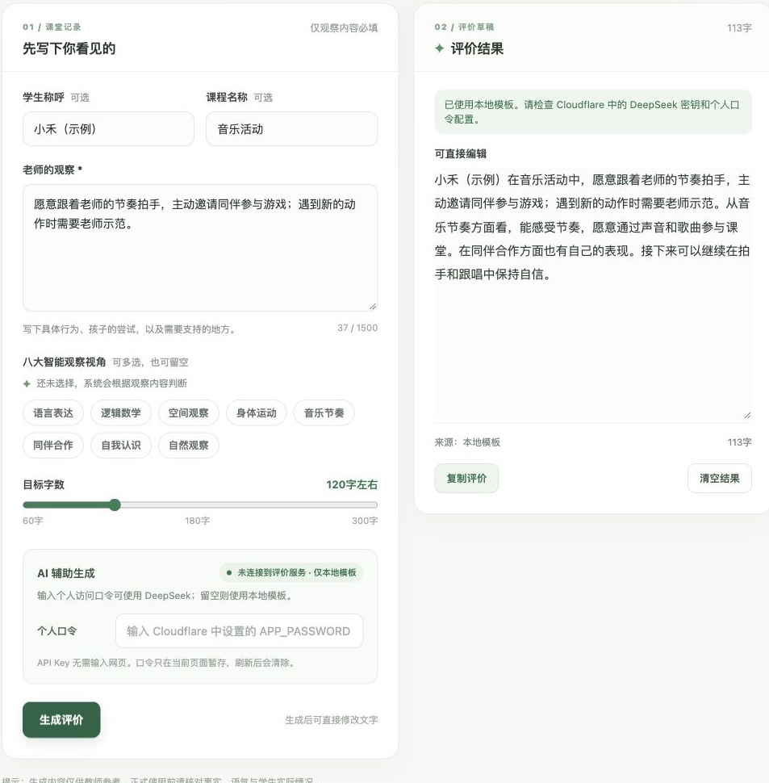

# 单人课程评价

[返回指南首页](Home.md)

适合临时写评语、润色课堂记录。生成后可以直接修改文字，再复制分享。

## 操作步骤

1. 填写“老师的观察”；学生称呼、课程名称可选。建议描述具体行为、孩子的尝试与需要支持的地方。
2. 选择智能观察视角，可多选，也可留空；目标字数可调至 60 至 300 字。
3. 需要 DeepSeek 时填写个人访问口令；口令留空时使用本地模板。
4. 点击“生成评价”。在右侧结果框中核对、修改，再点击“复制评价”。

## 判断结果来源

结果区会标明“DeepSeek”或“本地模板”。单人页面的 AI 调用失败时，会提示原因并自动改用本地模板。不要把 DeepSeek API Key 输入为个人口令。

[下一步：Excel 文件准备](Files-and-Matching.md)
