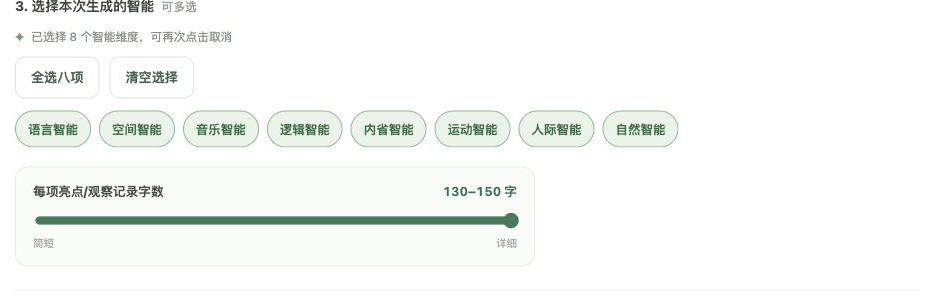

# 选择学生、智能与字数

[返回指南首页](Home.md)

## 智能与字数

默认勾选八个智能，每项观察记录目标为 130 至 150 字。点击标签可取消单项，也可使用“全选八项”“清空选择”。滑块可以调低字数；实际生成长度可能浮动。

## 只处理指定学生

1. 点击“取消当前名单”，再搜索并勾选需要处理的人。
2. 查看“已选 X / Y 人”，确认范围。
3. 按需筛选“未完成”或“有失败记录”。

> **筛选只改变显示，不改变勾选。** 隐藏的学生仍可能被选中；批量生成以勾选为准。

“全选当前名单”“取消当前名单”只影响当前显示的学生。未匹配学生不能勾选，需要先检查模板。

[下一步：先预览一人](Preview-and-Batch.md)
